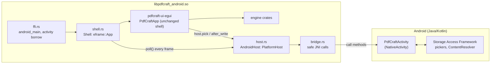
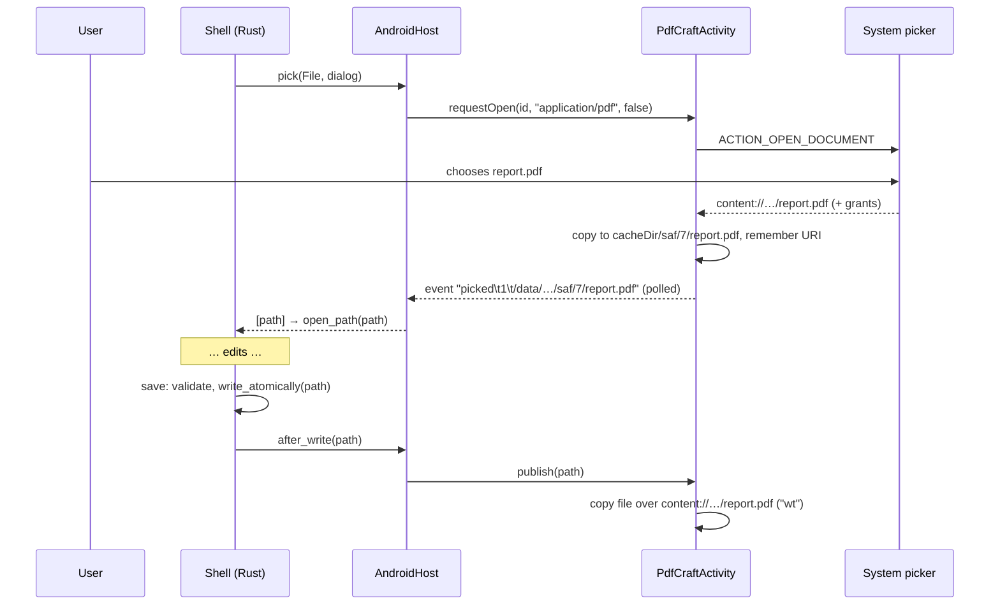

# PdfCraft for Android

Status: Phases 0–2 of the porting specification done (2026-10-16); a first phone layout and the
Back button (parts of Phases 4–5) added 2026-10-21. `cargo xtask android`
builds an installable debug APK for arm64-v8a (x86_64 also supported, not yet built). **Not yet run
on a device or emulator**: the build machine has neither (no `/dev/kvm`, no device attached), so
every on-device behaviour described here is designed and compiled but unverified. The
[device checklist](#device-checklist) is the first thing to run.

Contents: [Build](#build) · [Install, logs and debugging](#install-logs-and-debugging) ·
[Architecture](#architecture) · [Files and the Storage Access Framework](#files-and-the-storage-access-framework) ·
[The activity bridge](#the-activity-bridge) · [Where things are stored](#where-things-are-stored) ·
[Unsafe code](#unsafe-code) · [Rendering, fonts, theme, input](#rendering-fonts-theme-input) ·
[What works and what doesn't](#what-works-and-what-doesnt) · [Device checklist](#device-checklist) ·
[Troubleshooting](#troubleshooting) · [Decisions and deviations](#decisions-and-deviations-from-the-specification) ·
[Revision history](#revision-history)

Related: [phase0-report.md](phase0-report.md) (does the workspace build for Android) and
[devices.md](devices.md) (which renderer each tested device uses).

## Build

### Prerequisites

| Tool | Version | Install |
|---|---|---|
| Rust | stable ≥ 1.95 (built with 1.99.1) | `rustup target add aarch64-linux-android x86_64-linux-android` |
| cargo-ndk | ≥ 3.5 (built with 4.x) | `cargo install cargo-ndk` |
| Android SDK | platform 35, build-tools 35.0.0, platform-tools | `sdkmanager "platforms;android-35" "build-tools;35.0.0" "platform-tools"` |
| Android NDK | r27 or newer (built with r27c, 27.2.12479018) | `sdkmanager "ndk;27.2.12479018"` |
| JDK | 17 or newer (built with 21) | distribution package |
| Gradle | 8.10.2 | fetched by `cargo xtask android`; nothing to install |

`ANDROID_HOME` (or `ANDROID_SDK_ROOT`) must point at the SDK. `ANDROID_NDK_HOME` is optional; the
newest NDK under `$ANDROID_HOME/ndk` is used otherwise.

### Commands

```sh
cargo xtask android                      # arm64-v8a and x86_64, debug-signed APK
cargo xtask android --abi arm64-v8a      # one ABI (repeatable)
cargo xtask android --no-gradle          # only the Rust library
cargo xtask android --release            # also the release APK and AAB
```

What it does:

1. `cargo ndk -t <abi> --platform 26 -o android/app/src/main/jniLibs build -p pdfcraft-android --release`,
   with `CARGO_PROFILE_RELEASE_STRIP=true`. The workspace release profile (`lto = "thin"`,
   `codegen-units = 1`) applies; size isn't optimised at the cost of render speed.
2. Deletes every other `.so` cargo-ndk copied there. `boa_engine`, `ocrs` and `rten` declare a
   `cdylib` crate type, so their unused shared libraries would otherwise be packaged.
3. Runs Gradle (`assembleDebug`, plus `assembleRelease bundleRelease` with `--release`) in
   `android/`. Gradle 8.10.2 is downloaded once into `target/gradle/`, checked against its
   published SHA-256, so no `gradle-wrapper.jar` binary is committed. `PDFCRAFT_GRADLE=/path/to/gradle`
   uses another one.

Outputs:

| File | What |
|---|---|
| `android/app/src/main/jniLibs/<abi>/libpdfcraft_android.so` | the Rust library (git-ignored) |
| `android/app/build/outputs/apk/debug/app-debug.apk` | debug-signed, installable |
| `android/app/build/outputs/apk/release/app-release*.apk` | `--release` |
| `android/app/build/outputs/bundle/release/app-release.aab` | `--release`, for Play |

Release signing uses `ANDROID_KEYSTORE_PATH`, `ANDROID_KEYSTORE_PASSWORD`, `ANDROID_KEY_ALIAS`
and optionally `ANDROID_KEY_PASSWORD`; without them the release outputs are unsigned. No key is
ever generated or committed (`android/.gitignore` refuses `*.jks` and `*.keystore`).

Build time: the arm64 release library is the slow part (on the two-core build machine, the
better part of an hour even with dependencies already compiled for Android). The first Gradle run
took under 3 minutes; Gradle-only rebuilds (resources, Kotlin) take about a minute.

Optional: `CRAFT_FONTS_DIR=<craft-fonts checkout>` embeds the Japanese faces, as on the desktop.

## Install, logs and debugging

```sh
adb install -r android/app/build/outputs/apk/debug/app-debug.apk
adb shell am start -n app.pdfcraft.android/.PdfCraftActivity
adb logcat -s pdfcraft                     # the app's log
adb logcat | grep -E "pdfcraft|AndroidRuntime|DEBUG"   # with Java and native crashes
```

Panics are logged under the tag `pdfcraft` as `panicked at <file>:<line>: <message>` (the
default hook writes to stderr, which Android drops). The first lines of every run name the
version and the renderer, for example `renderer: wgpu; adapter: … (…, Vulkan)`.

Open a PDF from the command line, as another app would (`ACTION_VIEW`):

```sh
adb push sample.pdf /sdcard/Download/
adb shell am start -a android.intent.action.VIEW -t application/pdf \
    -d content://com.android.externalstorage.documents/document/primary%3ADownload%2Fsample.pdf \
    -n app.pdfcraft.android/.PdfCraftActivity
```

The app's private files (debug builds only): `adb shell run-as app.pdfcraft.android ls -R files cache`.

## Architecture



| Piece | Where | Responsibility |
|---|---|---|
| `PdfCraftActivity` | `android/app/src/main/java/app/pdfcraft/android/PdfCraftActivity.kt` | A `NativeActivity` subclass: SAF pickers, staging files in and out of the cache, `ACTION_VIEW`/`ACTION_SEND`, clipboard text, dark mode, opening links. A thin forwarder with no app logic; it never calls into Rust. |
| `ffi.rs` | `apps/pdfcraft-android/src/` | The only `unsafe` ([below](#unsafe-code)): exports `android_main` and borrows the activity's JNI reference. |
| `bridge.rs` | same | One safe function per Kotlin method; every failure is an error string. |
| `events.rs` | same | The text protocol the activity uses to answer ([below](#the-activity-bridge)); platform-independent and unit-tested on Linux. |
| `host.rs` | same | `AndroidHost`, the shell's `PlatformHost` on Android. |
| `shell.rs` | same | `Shell`, the `eframe::App` around `PdfCraftApp`: takes the activity's events each frame, sets the system theme, shows and hides the soft keyboard, forwards copied text to the clipboard. |
| `PlatformHost` | `crates/ui-egui/src/platform_host.rs` | The seam in the shell: `pick`, `after_write`, `after_pick` and the clipboard. `DesktopHost` (`hosts/desktop.rs`, rfd and arboard, unchanged behaviour) on desktops. |

The shell (`pdfcraft-ui-egui`) and every engine crate are the same code as on the desktop. Only
the `PlatformHost` seam and a few `cfg` gates were added (rfd and arboard aren't built for
Android, and eframe's `accesskit` feature is off there).

Startup: Android starts `PdfCraftActivity` → `onCreate` sets the environment
([below](#where-things-are-stored)) and calls `super.onCreate`, which loads
`libpdfcraft_android.so` (manifest `android.app.lib_name`) → android-activity starts a thread
and calls `android_main` → `run` sets up logcat logging and the panic hook, chooses the renderer
and calls `eframe::run_native` → `Shell::new` creates `PdfCraftApp`, restores its settings,
gives it the `AndroidHost` and turns on crash recovery.

Each frame, `Shell::logic` polls the activity (at most 64 events), opens documents that arrived
from other apps, shows queued notices, and runs `PdfCraftApp::logic`. Then it shows or hides the
soft keyboard to match whether egui wants text input. `Shell::ui` runs `PdfCraftApp::ui` and
sends any text copied in that frame to the system clipboard.

## Files and the Storage Access Framework

Android hands apps content URIs, not paths, and the user's documents are only reachable through
the system pickers. The shell's pickers give their follow-ups paths
(`pickers::Ask` → `then(app, Vec<PathBuf>)`). Rather than rewriting the 45 call sites to byte
buffers, the Android host **stages** documents in the app's cache and **publishes** what the
shell writes back to them.



| Action | Picker | What the shell gets | How the result reaches the user's storage |
|---|---|---|---|
| Open, Combine, Insert, image pickers… | `ACTION_OPEN_DOCUMENT` (multiple when the shell asks for several files) | `cacheDir/saf/<n>/<name>`, one copy per document | — |
| Save (in place) | none | the staged path the document was opened from | After the validated write, `after_write` → `publish` copies it over the original URI. A source without write permission (a mail attachment, a read-only provider) fails with "use Save As", and the document stays unsaved. |
| Save As, Export, Save a copy… | `ACTION_CREATE_DOCUMENT` with the proposed name and its MIME type | `cacheDir/saf/<n>/<name>` (not yet written) | `after_write` (PDF saves) or `after_pick` (everything else) copies it to the created document. Each file is published once per change: the size and modification time are compared, so Save As doesn't copy twice. |
| Split, Extract to files, batch results | `ACTION_OPEN_DOCUMENT_TREE` | an empty folder `cacheDir/saf/<n>/` | After the follow-up runs, `after_pick` creates each file it wrote there in the chosen folder. |
| Combine ▸ Add folder, Pin folder to Home | none | nothing | Not available yet; the user is told to choose the files instead. |
| A PDF opened from Files, Gmail, a browser… | `ACTION_VIEW` / `ACTION_SEND` | `cacheDir/saf/<n>/<name>` | Opens in a new tab, like a startup file on the desktop. Saving in place works only if the sending app granted write access. |

Rules the activity enforces:
- A document over 200 MB asks "Open it anyway?" first; one over 2 GB is refused and never read.
  The copy itself is capped at 2 GB, in case the provider misreports the size.
- File names from providers are cleaned (no `/`, `\`, control characters; at most 200
  characters; `.` and `..` refused) before they become a path.
- Persistable read and write permission is taken when the provider offers it, so Save keeps
  working for that document while the app runs.
- `"wt"` (truncate) is used to overwrite. Plain `"w"` is used only where a provider refuses
  `"wt"`, because on Android 10 `"w"` doesn't truncate.
- The validated-before-replace rule (commit `c1a41cc`) holds: the shell validates the PDF and
  writes the staged file atomically before anything is copied to the user's document.

Known gaps:
- The link from a staged file to its document is kept in memory only. After the app is killed,
  a document restored by crash recovery, or reopened from Recent files, must be saved with
  Save As. `cacheDir/saf/` is cleared at each start.
- Files a background worker writes into a picked folder *after* the follow-up returns (some
  batch exports) are not published yet (Phase 3, `fs-audit.md`).
- Folders chosen to write into are published flat: files in subfolders are not created.

## The activity bridge

Rust calls these `PdfCraftActivity` methods through JNI (`bridge.rs`); the activity never calls
Rust.

| Method | Signature | Use |
|---|---|---|
| `pollEvent()` | `()Ljava/lang/String;` | next event line, or `null` |
| `requestOpen(id, mimeTypes, multiple)` | `(JLjava/lang/String;Z)V` | `ACTION_OPEN_DOCUMENT`; `mimeTypes` comma-separated |
| `requestSave(id, name, mime)` | `(JLjava/lang/String;Ljava/lang/String;)V` | `ACTION_CREATE_DOCUMENT` |
| `requestFolder(id)` | `(J)V` | `ACTION_OPEN_DOCUMENT_TREE` |
| `publish(path)` | `(Ljava/lang/String;)Ljava/lang/String;` | `ok`, `skip` (not a staged document), or `error\t<message>` |
| `clipboardText()` | `()Ljava/lang/String;` | primary clip as text, or `null` |
| `setClipboardText(text)` | `(Ljava/lang/String;)V` | |
| `isDarkMode()` | `()Z` | `uiMode & UI_MODE_NIGHT_MASK` |
| `openUrl(url)` | `(Ljava/lang/String;)V` | http(s) and mailto only. **Not called yet**: links go through eframe's own link handling (the `webbrowser` crate), unverified on Android; if that fails on a device, `Shell` should forward `OutputCommand::OpenUrl` here instead. |

These names and signatures are kept through R8 by `android/app/proguard-rules.pro`.

Events (`events.rs`), one line each, fields separated by tabs:

| Event | Meaning |
|---|---|
| `picked\t<id>\t<path>␟<path>…` | picker `id` closed; paths separated by U+001F; empty when cancelled |
| `open\t<path>` | a document arrived from another app, staged |
| `theme\t0` / `theme\t1` | the system switched to light / dark |
| `trim\t<level>` | `onTrimMemory(level)`; logged (dropping page caches is Phase 3) |
| `error\t<message>` | shown to the user as a notice |

All of it is treated as untrusted. Malformed lines are dropped, paths must be absolute and free
of NULs, at most 1000 paths are taken per pick, and messages are cut to 500 characters.

A picker waits on a channel on the shell's picker worker thread, never on the UI thread. If
the activity can't show a picker, or goes away, the channel closes and the pick counts as
cancelled.

## Where things are stored

`PdfCraftActivity.onCreate` sets these before the library loads, so the shell's existing Linux
code (settings, crash recovery, temporary files) uses the app's private folders without
Android-specific paths. `/data/local/tmp`, Rust's default temp folder on Android, isn't
writable by apps.

| Variable | Value | Used for |
|---|---|---|
| `TMPDIR` | `cacheDir` | temporary files, atomic-write staging |
| `HOME` | `filesDir` | |
| `XDG_DATA_HOME` | `filesDir/data` | crash recovery (`data/pdfcraft/recovery`) |
| `XDG_CONFIG_HOME` | `filesDir/config` | |
| `XDG_STATE_HOME` | `filesDir/state` | |
| `XDG_CACHE_HOME` | `cacheDir` | |

| What | Where |
|---|---|
| Settings (eframe storage, key `pdfcraft`) | `filesDir/app.ron`, saved every 10 s and on exit |
| Crash recovery | `filesDir/data/pdfcraft/recovery/` |
| Staged documents | `cacheDir/saf/<n>/` (the OS may clear it; cleared at each start) |
| Renderer override | `filesDir/renderer` |

`android:allowBackup="false"`: nothing is sent to cloud backup. The app requests no
permissions, `INTERNET` included.

## Unsafe code

The workspace forbids `unsafe` (`unsafe_code = "forbid"`). An Android app can't exist without
two unsafe operations, and the owner approved exactly these on 2026-10-16:

1. **Exporting `android_main`.** android-activity's native glue calls this symbol by name, which
   needs `#[unsafe(no_mangle)]`.
2. **Borrowing the activity's JNI global reference.** android-activity only hands it out as a
   raw pointer (`AndroidApp::activity_as_ptr`), and `Env::as_cast_raw` wraps it without taking
   ownership. The `SAFETY` comment in `ffi.rs` gives the argument: the reference is owned by
   android-activity and valid for as long as the `AndroidApp`, and it is never wrapped in an
   owning `Global` or `Auto`.

So `apps/pdfcraft-android` declares its own lints (the workspace's, with `unsafe_code = "deny"`
instead of `forbid`), and only `src/ffi.rs` has `#![allow(unsafe_code)]`. Any other `unsafe` in
the crate fails to compile. Everything else is safe:
- the Java VM comes from `JavaVM::singleton()`, which android-activity sets up before
  `android_main`;
- every JNI call goes through the jni crate's safe API;
- pending Java exceptions are cleared after each call;
- because Rust polls the activity, the library exports no `Java_*` functions.

## Rendering, fonts, theme, input

**Renderer.** wgpu, which tries Vulkan and falls back to its own GLES backend. Put `gl` in
`filesDir/renderer` to start egui's OpenGL (glow) renderer instead:

```sh
adb shell run-as app.pdfcraft.android sh -c 'echo gl > files/renderer'
```

Record what each device uses in [devices.md](devices.md).

**Fonts.** The embedded faces (Inter, egui's defaults, craft-fonts when built with it) come
first. The last-resort fallback reads one installed face from `/system/fonts` at runtime and
checks it with skrifa before use. Candidates are Noto Naskh Arabic for Arabic, Noto Sans
Devanagari for Hindi, Noto Sans Telugu, and Droid Sans Fallback for Chinese where an older
device ships it. Nothing from them is embedded, shipped or written into a PDF (AGENTS.md §1.4).
Noto CJK is never used (AGENTS.md §1.1), so on most current devices the Chinese UI needs
craft-fonts or shows boxes.

**Theme.** The activity reports dark mode at start and on every configuration change.
`Shell::raw_input_hook` passes it to egui as the system theme, so Preferences ▸ Theme ▸ System
follows it without a restart.

**Keyboard.** The soft keyboard is shown while egui wants text input (a focused text field) and
hidden after. NativeActivity's soft keyboard sends plain key events: no IME composition
(Chinese/Japanese input methods, swipe typing) and no autocorrect.

**Clipboard.** Text copied in the app goes to the system clipboard. Create ▸ Clipboard reads
text from it. Copying images or files to the clipboard reports "not available on Android yet".

**Accessibility.** AccessKit isn't compiled in on Android: eframe's adapter needs GameActivity.
There's no screen-reader support yet.

## What works and what doesn't

| Area | State |
|---|---|
| Open from the picker, or from another app (`ACTION_VIEW`/`ACTION_SEND`) | implemented, unverified on a device |
| Render, scroll (one-finger drag), zoom with the toolbar | the shell's own code, unverified on a device |
| Organize (rotate, delete, reorder, insert, extract, split) | the shell's own code; split and extract write through the folder picker |
| Save, Save As, exports | implemented ([above](#files-and-the-storage-access-framework)) |
| Comments, forms, signing, redaction, OCR… | the shell's own code; not checked on Android, and OCR speed unmeasured |
| Dark mode, clipboard text, soft keyboard | implemented |
| Phone layout ([below](#phone-layout)) | implemented (2026-10-21), checked in phone-sized headless renders; on a device: first APK built, not yet reported back |
| Back button | closes the top dialog, menu or sheet, then goes from a document to Home, then puts the app in the background ([below](#phone-layout)) |
| Edge to edge: status bar, navigation bar, cutout, soft keyboard | the shell keeps clear of them through egui's safe area (`insets` events); unverified on a device |
| Pinch zoom | egui's multi-touch zoom feeds the page view's existing zoom; unverified on a device |
| 44 dp touch targets everywhere, long-press menus, tablet layout | **not yet** (Phase 4). The phone layout's own bars use 44-point targets; panels and dialogs inside it keep the desktop's sizes |
| Printing | unchanged desktop code; expect no printers (Phase 3: PrintManager or "not available") |
| Folder pickers that read (Add folder, Pin folder) | says "not available on Android yet" |
| Copy image/files to the clipboard | says "not available on Android yet" |
| Automation, MCP, `--control` | not compiled in (owner decision) |
| Screen readers | not yet (above) |

## Phone layout

Screens whose shorter side is under 600 points (Android's phone/tablet line, so a phone stays in
it when turned) get the compact layout in `crates/ui-egui/src/compact.rs`. Tablets keep the
desktop layout for now. Only the chrome changes; the page, Home, the panels' contents and the
dialogs are the shell's own:

| Desktop | Phone |
|---|---|
| Tab strip | Top bar: Home, the open documents as one menu (switch, close), Find, Open, ⋮ |
| Mode bar (Menu, modes, Save/Print/Properties) | Bottom bar with the five modes; ⋮ holds Save, Properties, Print and the main menu |
| Docked tools panel and inspector | One sheet over the lower part of the page, dragged taller or shorter, ✕ closes it. Tapping the current mode again shows or hides its tools |
| Right rail (panels, page, zoom) | Page bar above the modes: page ↑↓, page number, zoom, fit, side panels |
| Quick-action bar at the left edge, 70 pt gutters | Quick-action bar floating along the bottom, 8 pt gutters; pages fit the width the first time a document is shown |

Also: dialogs are capped to the screen's width (`widgets::dialog_width`), the Organize toolbar
scrolls sideways, Home shows its tools two to a row, and the ArtCraft community card is not in
the Android build (a fork must remove the brand).

Back (`compact::back`, called by `shell.rs` for the `BrowserBack` key winit reports): a dialog,
prompt, menu, the palette or full screen gets Escape, so each cancels the way it already does on
Escape; otherwise the sheet closes; otherwise a document goes Home (it stays open); at Home the
activity's `moveToBack` puts the app in the background, so nothing unsaved is lost.

To look at it without a device, render the shell headlessly at a phone's size:

```sh
cargo run -p pdfcraft-ui-egui --example shot -- out.png file.pdf --size 392x850 --scale 2 --ui-layout compact
```

`ui-layout` (`auto`, `desktop`, `compact`) is a shell option like `theme`; `auto` is compact only
on Android. Tests: `crates/ui-egui/tests/compact.rs`.

## Device checklist

The specification's Phase 1 and 2b acceptance, still to be run (none of it could be run on the
build machine). Record the device, Android version and renderer in [devices.md](devices.md).

1. Install and launch: the app opens to Home without a crash; `adb logcat -s pdfcraft` shows the
   renderer line and no `panicked at`.
2. Rotate the device, press Home, and return: no crash, the same state.
3. Toolbar ▸ Open: the system picker appears; choose a PDF; it renders and scrolls with a finger.
4. Organize: rotate a page; Save As to a new file through the system's "save" picker.
5. Open the saved file in another app (Files, Drive or a PDF viewer): the rotation is there.
6. Back in PdfCraft, rotate another page and Save (in place): reopen it elsewhere and check it.
7. Open a PDF from Gmail or Files ("Open with"), edit it, and Save: you are told to use Save As
   unless the sender granted write access; Save As works.
8. Split by pages into a folder chosen in the picker: the parts appear in that folder.
9. Switch the system to dark mode while the app is open: it follows (Preferences ▸ Theme ▸ System).
10. Tap a text field (Find): the keyboard appears, typing works, and it hides afterwards.
11. Copy text from a page and paste it into another app.
12. Edit without saving, `adb shell am kill app.pdfcraft.android` in the background, relaunch:
    recovery offers the document back (Phase 3 acceptance; expected to need Save As afterwards).

## Troubleshooting

| Symptom | Likely cause and fix |
|---|---|
| Black screen, or a crash right after launch, logcat mentions wgpu, Vulkan or the surface | The GPU driver; switch to OpenGL with `filesDir/renderer` (above) and report the device in devices.md. |
| The app draws under the status bar or the navigation buttons | `adb logcat -s pdfcraft \| grep insets` should show what the activity reported (pixels: left, top, right, bottom). None: the activity's insets listener didn't run. Present: the shell isn't laying out inside egui's safe area (`PdfCraftApp::ui`). |
| `java.lang.UnsatisfiedLinkError` in logcat | The `.so` is missing for that ABI: build that ABI (`--abi x86_64` for the emulator). |
| `NoSuchMethodError` from `bridge.rs` | A Kotlin method was renamed or R8 removed it; check `proguard-rules.pro`. |
| "This document can't be saved back to where it came from" | The source gave no write access; use Save As. |
| "This document is no longer linked to a file" | The app restarted since it was opened (crash recovery, Recent files); use Save As. |
| Chinese UI text shows boxes | No allowed CJK face on the device; build with craft-fonts or use another language. |
| The desktop UI tests (`cargo test -p pdfcraft-ui-egui`) segfault now and then, with `vkEnumerateInstanceExtensionProperties` / `libvulkan.so.1` and a null frame in the crashing thread's backtrace | The machine's Vulkan loader lists a GPU driver that can't load (here an NVIDIA ICD with a driver/library version mismatch), and parallel wgpu instance creation in the tests hits a null entry point. Not a PdfCraft bug: run the tests with `VK_ICD_FILENAMES=/dev/null` (wgpu then uses GL or software), or fix the driver install. |
| `cargo ndk` can't find a linker | `ANDROID_NDK_HOME` points at an old or broken NDK; use r27+. |
| Gradle: "SDK location not found" | `ANDROID_HOME` isn't set for the Gradle step (`cargo xtask android` passes it on). |

## Decisions and deviations from the specification

Owner decisions (2026-10-16):
- The Kotlin helper is approved as an exception to "Rust only".
- The automation crate is not compiled into Android.
- The one audited `unsafe` module above is approved.
- The package id `app.pdfcraft.android` and the name "PdfCraft" stay placeholders.
- The launcher icon is the owner's lion art: an adaptive icon on its own teal (`#11A58A`),
  contributor-original, credited to PdfCraft contributors.
- This round covers Phases 0–2, arm64 first.
- Phone layout (Phase 5) and PrintManager versus a stub (Phase 3) are decided later.
- The specification PDF lives in `plan/`, not in the tree.

Where the implementation differs from the specification, and why:
- **No Noto CJK fallback.** The specification lists `NotoSansCJK*`, but AGENTS.md §1.1 bans Noto
  CJK (Source Han rebranded), and AGENTS.md wins.
- **Staged paths instead of bytes at the picker seam.** The specification's trait passes
  `(name, bytes)` and needs every follow-up rewritten. Staging keeps the 45 path-based
  follow-ups unchanged, keeps the desktop's validate-then-write save path, and makes the trait
  smaller: `pick`, `after_write`, `after_pick` and the clipboard. `data_dir`, `open_url` and
  `fallback_font_paths` became the environment variables, egui's own link handling and an
  Android branch in `system_fonts.rs`. `print` is left for Phase 3.
- **`PdfCraftApp::new()` is kept**, with a public `host` field defaulting to the desktop host,
  instead of `new(host)`: dozens of tests and both other entry points call `new()`.
- **No `WebHost` yet.** The web build keeps its byte-based flows; `Dialog::to_rfd` feeds rfd's
  browser picker at the two places a dialog is shared with them.
- **Rust polls the activity** instead of the activity calling `Java_…_onFilesPicked`. That keeps
  `unsafe` to the two operations above and exports no JNI symbols.
- **jni 0.22**, not 0.21: android-activity 0.6.1 already uses 0.22 (one copy in the tree), and
  its `JavaVM::singleton()` makes getting the VM safe.
- **No Gradle wrapper jar.** Gradle is pinned by version and SHA-256 and fetched by xtask instead.
- **No separate Phase 1 branch.** A placeholder "blank window" app was skipped; the first app
  built was the real one (`android/phase-2b-android-host`).
- **Phase 0 was cut short** by the owner's choice and completed by the app build
  ([phase0-report.md](phase0-report.md)).

Budget misses for the owner (specification, "Performance budgets"): the arm64 library is
**47.3 MB stripped** against a 40 MB budget (APK 49.5 MB). Likely cause: the whole engine
(boa, rten/ocrs, hayro, wgpu, the RustCrypto stack, aws-lc) in one library at `opt-level = 3`.
Options: `opt-level = "s"` for crates off the render path, OCR models and boa behind features,
or accepting it. Nothing else has been measured yet; that needs a device.

## Revision history

- 2026-10-21: Phone layout (Phase 5, first pass) and Back (Phase 4): `compact.rs`, edge-to-edge
  drawing with the system insets as egui's safe area, status bar icons that follow the app's
  theme, dialogs capped to the screen's width. Fixed after the first device run: egui gives the
  app the whole screen, so the shell now lays itself out inside the safe area itself (it had
  drawn under the status bar and the navigation buttons).

- 2026-10-16: Troubleshooting: UI-test segfaults from a broken Vulkan driver install. The commit
  before this one (213b837) blamed `vello_cpu`; that came from reading the wrong thread's
  backtrace, and is corrected here.
- 2026-10-16: First version (Phases 0–2): build, architecture, SAF staging, bridge protocol,
  storage, unsafe audit, device checklist, decisions. The launcher icon became the owner's lion
  art. `copyOut` falls back from `"wt"` to `"w"` only where a provider refuses truncation.
